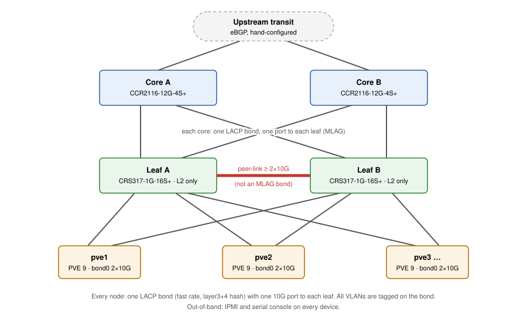
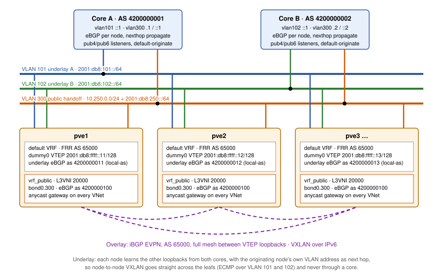
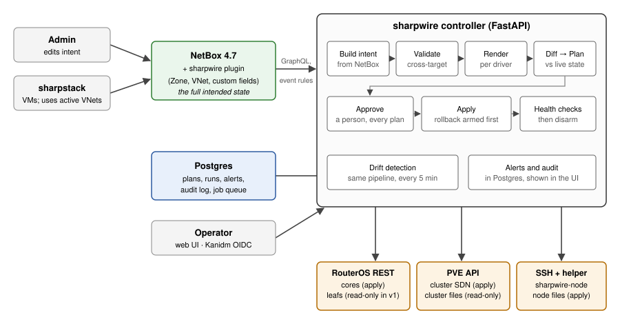

# High-level design: Proxmox EVPN network and sharpwire

Nov 20, 2026 · Draft

This is the high-level design of the platform network and of sharpwire, the controller that keeps it in the state NetBox describes. It explains what the network is, why it's built this way, and how it's operated. It has no device config: the [network doc](proxmox-evpn-ipv6-underlay.md) has the step-by-step config, and the [sharpwire design docs](../README.md) have the controller's detail. Where this HLD and those documents disagree, they win.

The addresses and ASNs are the documentation examples used throughout the design.

## 1. Summary

- **Proxmox VE nodes are VTEPs.** VMs attach to EVPN/VXLAN VNets. The anycast gateway for every VNet runs on every node, so a VM is routed by the node it runs on.
- **IPv6-only underlay and management.** Hosts have no IPv4 outside the tenant VRFs.
- **A routed, not switched, fabric core.** Two MikroTik CCR2116 cores run eBGP to every node. A MikroTik CRS317 leaf pair is L2 only, using MLAG.
- **Cores in the control plane, not the east-west data plane.** The cores pass on the originating node's next hop, so node-to-node traffic crosses only the leafs.
- **Public zone in phase 1.** One shared VRF with public IPv4 and IPv6. Each node hands traffic straight to the cores over eBGP. There's no VRRP and no middlebox; customers are isolated by the Proxmox firewall.
- **Customer NAT zones (VPC) in phase 2.** One VRF per customer, with traffic leaving through a VyOS gateway pair.
- **NetBox holds the full state.** sharpwire renders every device's config from NetBox, detects drift, and applies only plans a person has approved, with a rollback armed on the target first.

## 2. Scope

| In scope | Out of scope |
| --- | --- |
| Leaf pair, cores (underlay and public handoff), Proxmox host networking and FRR, Proxmox SDN, the corosync and migration network | Upstream transit, the mgmt gateway (VRRP) and the core firewall, which are hand-configured in v1 |
| The public zone (phase 1) | Guests, storage, Ceph, HA groups, PVE users and ACLs |
| Customer NAT zones and VyOS (phase 2, design only here) | The per-VM firewall, which sharpstack owns |
| How sharpwire operates all of the above | Firmware and PVE upgrades |

## 3. Physical topology

| Role | Hardware | Count | Function |
| --- | --- | --- | --- |
| Core | CCR2116-12G-4S+, RouterOS 7 | 2 | Underlay eBGP to every node, the public handoff, upstream transit, the mgmt gateway |
| Leaf | CRS317-1G-16S+, RouterOS 7 | 2 | L2-only MLAG pair; no routing apart from its own mgmt address |
| Proxmox node | PVE 9.x | 3 to start, tens within a year | Compute, VTEP, anycast gateway, public handoff |
| EVPN gateway (phase 2) | VyOS 1.5, VMs or appliances | 2 | Customer NAT zones' exit, source NAT |

- Every node and each core has **one LACP bond with a port on each leaf**. MLAG makes the two leafs look like one switch, so a leaf or a link can fail without the bond going down.
- The **peer-link** between the leafs carries every VLAN, because node-to-node traffic crosses it whenever the two ends hash to different leafs. It's sized for east-west load.
- **Jumbo frames end to end:** 9216 MTU on the bonds and underlay, `l2mtu` of at least 9220 on every leaf and core port. VM-facing MTU is 1500, leaving room for the 70-byte IPv6 VXLAN overhead.
- **Out-of-band access** through IPMI and serial console is required. The management API and SSH run in-band.

## 4. VLANs

All VLANs ride the same bonds.

| VLAN | Purpose | Members | Addressing | MTU |
| --- | --- | --- | --- | --- |
| 10 | Management: GUI, SSH, API, corosync, migration, apt | Nodes, cores, leafs | 2001:db8:100::/64; default gateway `::1` (VRRP on the cores) | 1500 |
| 101 | Underlay A | Nodes, core A (phase 2: VyOS) | 2001:db8:101::/64 | 9216 |
| 102 | Underlay B | Nodes, core B (phase 2: VyOS) | 2001:db8:102::/64 | 9216 |
| 300 | Public handoff, inside `vrf_public` on the nodes | Nodes, both cores | 10.250.0.0/24 + 2001:db8:250::/64 | 9216 |
| 310 | NAT outside (phase 2) | VyOS hosts, both cores | 10.250.1.0/24 + 2001:db8:251::/64 | 1500 |

Each underlay VLAN has exactly one core on it. Two VLANs give every node two independent paths to every other node, and a core failure removes only one of them.

## 5. Addressing and numbering

| Item | Example | Rule |
| --- | --- | --- |
| VTEP loopbacks | 2001:db8:ffff::/64 | One /128 per node on `dummy0`; the source of VXLAN and of the EVPN sessions |
| Public subnets | 198.51.100.0/24 + 2001:db8:70::/48 | Carved into VNet subnets no longer than a set maximum length (/28 and /64 in the example) |
| Node underlay ASN | 4200000011, 4200000012, … | Unique per node, or a node drops the other nodes' routes as AS-path loops |
| Core ASNs | 4200000001, 4200000002 | One per core |
| Public handoff ASN | 4200000100 | Shared by every node, so the cores see identical paths and can ECMP across nodes |
| Overlay ASN | 65000 | The FRR process ASN on every node; EVPN is iBGP inside it |
| BGP router-id | 10.255.0.11, … | Unique 32-bit ID per node, set through `dummy0`'s MAC because there's no IPv4 to derive it from |
| Public VNets | `vnet200` … `vnet999`, tag = VNI | Shared platform capacity, used by sharpstack |
| Public zone L3VNI | 20000 | VRF `vrf_public` |

Every address and number is recorded explicitly in NetBox. IPv4 and IPv6 host numbers don't have to match.

## 6. Routing

### Underlay

- Each node runs **eBGP to the core on each underlay VLAN**, presenting its own ASN with `local-as`. The FRR process itself is AS 65000, because the EVPN controller owns that BGP instance.
- Nodes advertise **only their own loopback /128**. The cores accept from each node only that /128, and send back only VTEP /128s. No default route or other prefix enters a host's table from the underlay; the only host default is the static one on mgmt.
- The cores **pass the next hop through** (`nexthop-choice=propagate`). A node learns another node's loopback with that node's own address on the VLAN as next hop, so VXLAN between nodes goes directly across the leafs. Only north-south traffic is routed by a core.
- Each node has **two equal paths** to every other loopback, one per VLAN, and load-balances across them.
- **BFD** at 300 ms × 3 on every session. A dead core or node is withdrawn in under a second.

### Overlay

- **iBGP EVPN** in AS 65000, a full mesh between node loopbacks, with BFD. In phase 2 the VyOS gateway VTEPs join the mesh.
- Proxmox SDN generates the overlay from one EVPN controller and its zones. The underlay and the public handoff are added per node in `frr.conf.local`, which SDN merges into its generated config. That merge has sharp edges (it drops BFD profiles, and duplicated settings reset sessions on every apply), so what may go in that file is a fixed rule set.
- The cores are **not in the overlay**. They never run EVPN or carry tenant VRFs, so RouterOS's EVPN limitations don't matter.

### Public zone

- One EVPN zone, `public`, with one VRF (`vrf_public`, L3VNI 20000). Every VNet's gateway is an anycast address on every node.
- Each node's `vrf_public` peers **eBGP with both cores on VLAN 300**, in IPv4 and IPv6, using the shared ASN 4200000100. The cores listen on the whole subnet, so adding a node needs no core change for the handoff.
- **Nodes send only the public subnets**, never VM host routes, so a node doesn't attract traffic for VMs it doesn't host. **The cores send only default routes.** Nodes don't share their defaults with each other over EVPN.
- **Outbound,** a VM's traffic leaves the node it runs on, straight to a core.
- **Inbound,** the cores spread traffic across every node advertising the subnet. If the VM is on another node, the receiving node forwards it once over VXLAN.
- The cores announce the public aggregates upstream.

### Customer NAT zones (phase 2)

- One EVPN zone and VRF per customer (`cNN`, L3VNI 100NN). Private IPv4 ranges may overlap between customers, and each customer has a routed IPv6 /56.
- The zones have no exit on the nodes. Traffic reaches the **VyOS gateway pair** over EVPN. VyOS source-NATs each customer's IPv4 to that customer's single public IPv4, routes IPv6 without NAT, and connects to the cores on VLAN 310.
- Customers can reach each other only through their public addresses, as from the internet. VyOS keeps connection tracking separate per customer, so overlapping ranges don't collide.

## 7. Traffic flows

| Flow | Path |
| --- | --- |
| VM to VM, same VNet or zone, different nodes | Node → VXLAN directly over the leafs → node. Never through a core |
| Public VM to the internet | Node's `vrf_public` → VLAN 300 → either core (ECMP) → upstream |
| Internet to a public VM | Upstream → core → any node advertising the subnet (ECMP) → VXLAN to the VM's node if needed |
| Public VM to a customer VM (phase 2) | Through the cores and VyOS, as public traffic. Policy between zones is set on the cores |
| Customer VM to the internet (phase 2) | Node → VXLAN to a VyOS VTEP (routed by a core) → source NAT → VLAN 310 → core → upstream |
| Host traffic: GUI, SSH, API, corosync, migration, apt | VLAN 10 only, via the mgmt default route |

## 8. Resilience

| Failure | Effect | Recovery time |
| --- | --- | --- |
| A bond member or one leaf | LACP and MLAG carry on over the other leaf; BGP sessions stay up | LACP: about 3 s for a link that's up but not forwarding, immediate for link-down |
| One core | Its underlay and VLAN 300 sessions drop; node-to-node traffic uses the other VLAN's paths, public traffic the other core. EVPN stays up | BFD, under 1 s |
| One node | The cores withdraw its loopback and its public-subnet advertisements; inbound traffic shifts to the other nodes. HA restarts its VMs elsewhere | BFD, under 1 s; then HA |
| One VyOS gateway (phase 2) | NAT traffic moves to the other gateway; existing IPv4 NAT sessions break unless state is synced | BGP preference |
| A VLAN missing on the peer-link or a bond | Some node pairs fail silently: BFD and BGP can't see it | Prevented by validation, and checked continuously against live state |

Corosync link0 runs on the mgmt VLAN with a high 802.1p priority. A low-priority link1 over the VTEP loopbacks takes a different L3 path through the cores, as a backup only, so quorum doesn't depend on BGP convergence.

## 9. Security and isolation

- **No VM touches the host networks.** VMs attach only to SDN VNets; there is no general-purpose bridge on the host bond, and leaf edge ports admit only tagged frames.
- **Tenant VRFs never touch the host's default VRF.** Neither zone uses Proxmox exit nodes.
- **Strict route filters on every session:** loopbacks only in the underlay, public subnets out and defaults in at the handoff.
- **Public-zone customers** are isolated by the PVE firewall, which sharpstack manages. Phase-2 customers are isolated by having separate VRFs.
- **Management** is reachable only on VLAN 10, plus out-of-band access.

## 10. Operations: sharpwire

### Source of truth

**NetBox holds the full intended state.** It describes the devices, cabling, bonds with their MLAG IDs and tagged VLANs, addresses, VLANs, prefixes, ASNs and router-ids. A small sharpwire plugin adds Zone and VNet models and a few custom fields. Every value on a device comes either from NetBox or from a **named rule**: a fixed shape or constant written down in the [intent model](../02-intent-model.md#rules), such as the LACP mode or BFD timers. Nothing is configured by hand on a managed object.

### Targets

| Target | How sharpwire talks to it | v1 |
| --- | --- | --- |
| Each core | RouterOS REST over HTTPS | Apply: only the config sharpwire renders. Other config, such as upstream, VRRP and the firewall, is reported, never removed |
| Each leaf | RouterOS REST | Drift detection only |
| The Proxmox cluster | PVE API | Apply SDN. Corosync, `datacenter.cfg` and the firewall `enable` are drift-only |
| Each Proxmox node | SSH, through a restricted helper (`sharpwire-node`) | Apply host networking, `frr.conf.local`, sysctl and `/etc/hosts` |

sharpwire is the **only writer of Proxmox SDN**. sharpstack manages guests and the per-VM firewall, and uses only VNets sharpwire has applied.

### How a change happens

1. **Build and validate.** sharpwire reads NetBox and checks the whole network as one model before rendering anything: unique ASNs, one core per underlay VLAN, the right VLANs on every bond and on the peer-link, MTUs, public subnets inside their ranges. These checks catch the failures BFD and BGP can't see.
2. **Plan.** It renders each target's config, compares it with live state, and produces a plan: an ordered list of changes, their inverses, and a readable diff. Drift detection is the same pipeline, run every 5 minutes: any non-empty plan is drift.
3. **Approve.** A person approves every plan in the web UI. Risky changes show as warnings. **Hard guards** can't be overridden: a plan may not change the management path the controller depends on, leave a redundant pair with no healthy member, or remove a VNet that's still in use.
4. **Apply with a rollback armed first.** If live state changed since the plan, the approval is void. Otherwise sharpwire arms a rollback on the target, applies, checks health from a new session, and disarms only if all is well.

| Target | Rollback |
| --- | --- |
| Core | An inverse-op script with two RouterOS schedulers, at T+5 min and at boot |
| Node | A systemd timer at T+10 min, plus a restore unit that runs at boot if the node reboots mid-apply (for example when HA fences it) |
| Cluster SDN | Driven by the controller: re-stage the previous SDN config and apply again |

5. **Roll out one at a time.** Core A, then core B; nodes one by one, waiting for corosync. A failure stops the rollout. Each target has a lock, so no two applies overlap.

### Platform

One controller (Python, FastAPI), with its own Postgres for plans, runs, alerts, the audit log and the job queue. Staff log in with Kanidm. Credentials come from secret files. Alerts are stored in Postgres and shown in the UI; there is no paging in v1.

## 11. Phasing

| Phase | Network | sharpwire |
| --- | --- | --- |
| **1: Public network** (v1 is its minimal slice) | Leafs, cores, Proxmox nodes and the `public` zone | Drift on everything; apply to cores, SDN and node files; one plan per target, applied in a documented order |
| **2: VPC** | Customer NAT zones, the VyOS pair, NAT outside on the cores | VyOS driver, change sets, automated customer onboarding |

[Later and phase 2](../later.md) lists everything designed but not in v1.

## 12. Key decisions

| Decision | Why |
| --- | --- |
| IPv6-only underlay and mgmt | No IPv4 to plan or exhaust on the host side; PVE 9 supports an EVPN IPv6 underlay |
| Shared underlay VLANs with one core each, not point-to-point links | Lets the cores pass node next hops through, so east-west traffic stays on the leafs at line rate |
| Cores outside the overlay | RouterOS isn't a dependable EVPN speaker yet; the cores stay simple routers |
| Direct public handoff from every node, with no exit nodes or VRRP | No bottleneck node and no middlebox; the anycast gateway replaces VRRP |
| Per-node ASN with `local-as`, a shared handoff ASN | Loop-free underlay paths; identical paths for ECMP at the handoff |
| FRR's default BFD timers | Proxmox's merge drops BFD profiles |
| NetBox as the full state, and a person approving every plan | One model for the whole network enables cross-device checks, and nothing changes unseen |
| Rollback armed on the target before every change | A change that cuts the management path reverts itself |

## 13. Risks and open questions

| Risk | Mitigation |
| --- | --- |
| A bad SDN apply reaches every node at once | Validation, the lab gate, strict apply preconditions, a controller-driven restore |
| A change cuts management or corosync, and HA reboots the node onto the broken config | The armed timer and boot-time restore, the mgmt hard guard, one node at a time, out-of-band access |
| Proxmox's `frr.conf.local` merge drops a line or resets sessions on every apply | The fixed rule set for that file, checks after every merge, golden tests of the merge |
| A VLAN missing on the peer-link breaks node pairs unseen | The leaf VLAN rule, checked continuously |
| Corosync shares links with VM traffic | 802.1p priority on mgmt and a backup link1; a dedicated NIC if token timeouts ever appear |
| Behaviour changes between RouterOS and PVE releases | Pinned versions, a hardware lab gate |

Open:
- Leaf STP priority and ICCP values, set when the leafs are first configured.
- Which spike findings still need the labs: SDN apply end to end, overlay BFD during a core failure, BFD from the cores to FRR, MLAG and `l2mtu` on hardware ([testing](../08-testing-build-plan-risks.md)).

## References

- [Network doc](proxmox-evpn-ipv6-underlay.md): step-by-step config, verification and troubleshooting.
- [sharpwire design docs](../README.md): the intent model, pipeline, drivers, apply and rollout, security.
- [sharpstack integration](../09-sharpstack-integration.md): who owns what between sharpwire and sharpstack.
